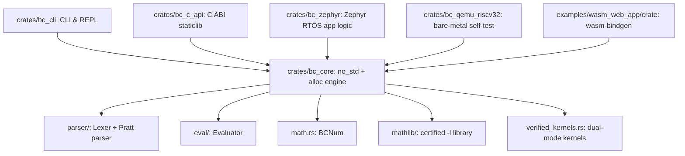

# bc_clone_rs: Design, Verification Architecture & Agent Guide

This document describes the architecture, numerical algorithms, and verification strategy of
`bc_clone_rs`, a Rust implementation of the POSIX `bc` calculator (binary: `bc_clone`). It is the
reference for both human contributors and AI coding agents.

> Development history: v0.1.0–v0.3.0 were written by the Antigravity agent. From v0.4.0 the project
> is developed with Claude Code. Statements in this file are kept in sync with the code; when you
> change behavior or verification coverage, update this file in the same commit.

## Specification

- **Authoritative specification**: POSIX.1-2024 (Issue 8), `bc` utility —
  <https://pubs.opengroup.org/onlinepubs/9799919799/utilities/bc.html>.
- Where POSIX leaves behavior undefined or unspecified, `bc_clone` chooses behavior close to
  GNU `bc` 1.08 and documents it as implementation-defined in `docs/COMPATIBILITY.md`.
- The GNU extensions listed in `docs/COMPATIBILITY.md` §4 (multi-letter names, relational
  expressions as statements, `return` without parentheses, one-line function bodies) are accepted
  by default; `-s` rejects and `-w` warns about them. `else`, `print`, `continue`, `&&` and the
  other GNU additions are not supported.
- The executable specification in `crates/bc_spec` encodes POSIX and these implementation-defined
  choices as a function from input bytes to stdout, stderr and exit status. It is the primary
  oracle of the differential tests; GNU `bc` remains a secondary check of the specification.
- Results of the `-l` math library are defined as the mathematically exact value truncated toward
  zero at the current `scale`; GNU `bc` output is *not* the oracle for these functions.

## Workspace Layout



| Path | Role |
|---|---|
| `crates/bc_core` | `#![no_std]` + `alloc` engine: lexer, parser, evaluator, arithmetic, math library (`mathlib/`) |
| `crates/bc_cli` | `bc_clone` binary: option parsing, file/stdin processing, interactive REPL, SIGINT |
| `crates/bc_c_api` | C ABI (`include/bc_core.h`): `bc_eval`, `bc_eval_callback`, `bc_session_*` |
| `crates/bc_zephyr` | Zephyr RTOS application logic (self-tests, serial REPL); C trampoline in `examples/zephyr_app` |
| `crates/bc_qemu_riscv32` | Bare-metal RISC-V 32 self-test runner for QEMU `virt` |
| `crates/bc_spec` | Executable formal specification: Verus `spec fn`s from input bytes to stdout, stderr and exit status, compiled by `exec_spec_verified!` into the reference interpreter `bc_spec_oracle` (`scripts/build_spec_oracle.sh`). A workspace member outside `default-members`: `cargo verus verify -p bc_spec` checks it, and a normal `cargo build` compiles the oracle, because `verus!` erases the specifications |
| `examples/m5stamp_c3` | ESP32-C3 bare-metal app (`esp-hal`) |
| `examples/wasm_web_app` | Browser frontend backed by `bc_core` compiled to `wasm32-unknown-unknown` |

## Core Engine (`crates/bc_core`)

### Lexer and parser (`src/parser/`)
- The lexer works on bytes, which need not be UTF-8. It tracks line numbers and handles
  `/* */` comments, strings, and backslash-newline continuation. A string keeps its bytes
  (`Stmt::StringLiteral(Vec<u8>)`). An illegal character is the well-formed UTF-8 sequence
  that starts at that byte, or the byte alone (`verified_utf8_char_len`).
- The parser is recursive descent, with Pratt precedence climbing for expressions. Assignment and
  `^` are right-associative. Precedence and associativity come from `verified_pratt_infix_info`.
- Fallible API: `Lexer::try_get_next_token`, `Parser::try_new`, `Parser::try_parse_program`.
  `quit` makes `try_parse_program` return `Err("quit")` so execution stops at that point, as
  POSIX requires.

### Numbers (`src/math.rs`)
- `BCNum { coeff: BigInt, scale: usize }` represents `coeff × 10^-scale`. Arithmetic follows the
  POSIX scale rules. The scale and shift computations are delegated to kernels in
  `verified_kernels.rs`.
- `add`, `sub`, `mul`, `try_div`, `try_mod_op`, `try_pow`, `try_sqrt`, `length`, `scale_func`,
  `cmp_val` (comparison) and `from_digit_values` (the value of a constant) are written inside
  `verus!` and proved to compute the L0 operations of `spec_num` and `bc_spec` (`spec_add`, …,
  `spec_pow`, `is_isqrt`, `is_digit_count`, `spec_horner`, through `BCNum::val`), given scales of
  at most `BC_SCALE_MAX`. They use `BigInt` only through `trusted_bigint.rs`, whose one-line
  wrappers Verus assumes correct (each is checked by a test). The output `format_bytes` (`src/format.rs`) is
  proved to write the specification's `l0_format` of the value for every `obase` from 2 to
  `BC_BASE_MAX`. Constants are read with the verified `math::literal_digit_values`, by the
  evaluator and by the public `BCNum::try_from_string` alike.
- Public API: nothing checks the scale bound of these operations at run time, so they are
  `pub(crate)`, as are `format_bytes` and the `-l` functions; the evaluator is their only
  caller. Outside the crate a `BCNum` is built with `new`, `zero` or `try_from_string` and
  printed with `try_format_obase`. These two conversions check their preconditions in verified
  code (`from_digit_values_checked`, `checked_format_bytes`) and return `BaseOutOfRange` or
  `ScaleTooLarge`. Do not make a function with a `requires` clause public.
- Fallible API: `try_from_string`, `try_format_obase` (public), and inside the crate `try_div`,
  `try_mod_op`, `try_pow`, `try_sqrt`. The panicking wrappers (`from_string`, `format_obase`,
  `div`, `pow`, …) are compiled only under `cfg(test)`, as are `Lexer::get_next_token`,
  `Lexer::peek_token`, `Parser::new`, `Parser::parse_program`, `Evaluator::evaluate`, and
  `Evaluator::execute`.
- Output for `obase != 10` uses exact `BigInt` arithmetic. The number of fractional digits is the
  smallest `k` with `obase^k >= 10^scale`, so no floating point or `libm` is needed.

### Math library (`-l`, `src/mathlib/`)
Every function computes a **ball** (midpoint and radius in ulps of a working precision) that
provably contains the exact value. Each ball operation carries its own error bound, and series
add a bound on their omitted tail. `certified_trunc` returns the truncation to `scale` only if
every value in the ball truncates to it; otherwise `certify` doubles the guard digits and
recomputes (Ziv's strategy). Exact results (`s(0)`, `c(0)`, `a(0)`, `e(0)`, `l(1)`, `j(n,0)`) are
returned directly; every other result is transcendental, so the loop ends.
`docs/MATH_ERROR_BOUNDS.md` derives every bound.

| Function | Algorithm (as implemented) |
|---|---|
| π, ln 2 (internal) | Machin's formula `π = 16·atan(1/5) − 4·atan(1/239)` and `ln 2 = 2·artanh(1/3)`, summed with exact integer terms (`arc_inv`) |
| `s(x)`, `c(x)` | Reduce `x` by the integer multiple of 2π nearest to it, with π carrying one extra digit per integer digit of `x` (`reduce_angle`), then the Taylor series |
| `a(x)` | For `|x| > 1` use `π/2 − atan(1/|x|)`. Then four argument halvings `y/(1+√(1+y²))`, the Taylor series, and multiply by 16 |
| `l(x)` | Write `x = m·2^k` with `m` in `[0.7, 1.43)`, then `ln m = 2·artanh((m−1)/(m+1))`, plus `k·ln 2` |
| `e(x)` | Write `x = n·ln2 + r`, the Taylor series for `e^r`, then multiply by `2^n`. Results that truncate to 0 are returned without computation; `|x|` above `EXP_ARG_MAX` is an error |
| `j(n,x)` | Power series of `J_n`; for negative orders, `J_{-n} = (-1)^n J_n`. Orders large enough that the result truncates to 0 return 0 without computation |

Accuracy contract: every result is the exact value truncated toward zero
(`docs/COMPATIBILITY.md` §3.4). Verus proves this in place for all six functions (`bc_sin`,
`bc_cos`, `bc_atan`, `bc_ln`, `bc_exp`, `bc_bessel`): an `Ok` result has the caller's scale and is
the exact value truncated toward zero at that scale. The proof covers the ball operations, the
truncation decision and the retry loop (`certify`), the constants, every series with its tail
bound, and every argument reduction (lemmas in `real_arith.rs` and `mathlib/`). It assumes the
facts of real analysis stated as axioms in `trusted_math.rs`, and it is partial correctness (that
a series loop ends is argued in `docs/MATH_ERROR_BOUNDS.md`, not proved). The tests remain
(`mathlib::tests`, and `test_math_library_against_high_precision_oracle`, which compares with GNU
bc at `scale + 100`).
GNU's own results are *not* exact at the requested scale. When you change a function, keep its
section of `docs/MATH_ERROR_BOUNDS.md` in sync.

### Evaluator (`src/eval/`)
- Dynamic scoping: each variable or array name maps to a stack. Function parameters and `auto`
  locals push a new entry on entry. `BTreeMap` keeps the storage `no_std`-friendly and deterministic.
- `Evaluator::leave_call` pops the parameter and `auto` frames and restores the caller's
  control-flow flags and invocation `ibase` on every return path of a call, including `Err`
  returns (`run_call_ref`). It is called explicitly (there is no RAII guard, which Verus cannot
  reason about), so a panic inside a call would leave the frames pushed; `bc_core` must not
  panic.
- Output goes through the `BcWriter` trait. `WrappedStdout` wraps long numbers at 70 columns with
  `\` + newline, as POSIX requires. The wrapping itself is `format::wrap_output`, verified against
  the specification's `write_wrapped`; `write_str` passes its result to the writer in one call.
- Fallible API: `Evaluator::try_evaluate`, `Evaluator::try_execute`.
- The evaluator's state (variables, arrays, functions, registers, flags, output streams) is
  `pub(crate)`, so `Evaluator::inv` is established by `new` (the verified `with_streams`) and
  kept by the verified functions alone, the public setters included; the documentation of
  `inv` gives the argument. Front ends configure it (`set_scale`, `max_depth`, `extension_policy`) and use
  `stderr_writer`, `request_quit`, `clear_quit` and `reset_control_flags`; do not add a method
  that stores a number without going through the verified storage layer.

### Error handling contract
- `bc_core` itself never needs to panic on user input. Every syntax or runtime error must be
  reachable as an `Err` from the `try_*` APIs.
- `lib.rs` denies `clippy::unwrap_used`, `expect_used`, `panic`, and the lossy-cast lints outside
  tests. Every remaining exception is an `#[allow(..., reason = "...")]` that names the invariant
  justifying it (the Verus-proved casts in `verified_kernels.rs`, `math.rs` and `mathlib/`). Do not replace an `unwrap` with a silent default (`unwrap_or(0)`):
  return an error or derive the value so that no default is needed.
- Front ends must not rely on unwinding: `catch_unwind` does not work under `panic = "abort"` or on
  `wasm32-unknown-unknown`.
- Errors are typed: `BcError` (`Quit`, `Syntax`, `Runtime { kind: RuntimeError, func }`) in
  `src/error.rs`. Do not match on message strings.
- `src/driver.rs` is the only place that turns input into executed units. `UnitAccumulator`
  groups lines into units, `Evaluator::run_unit` / `run_source` parse and execute them, and
  diagnostics are written in the format of `docs/COMPATIBILITY.md` §3.2. `run_unit` only runs
  the parser; the verified `run_parsed` executes the statements and writes every diagnostic. Every front end (CLI,
  C API, Zephyr, QEMU, ESP32-C3, Wasm) uses this driver, so error recovery is identical on all
  targets. The driver takes bytes; the CLI and the C API pass their input without decoding it.
- Recursion is bounded: `Evaluator::max_depth` limits the depth of the syntax tree (checked while
  parsing, so evaluation, `Clone`, and `Drop` of the tree stay within it) and the number of
  nested `try_evaluate`/`try_execute` calls, including across function calls. Each front end
  sets it for the stack it runs on; `bc_cli` runs the engine on a 512 MiB-stack thread. When
  you add a recursive walk over the AST, it must stay within the same bound.
- `bc_cli` additionally wraps each unit in `catch_unwind`. A panic there is a bug in `bc_core`; it
  is reported as `bc_clone: internal error: …` and counted as a failed unit. After such a panic
  the evaluator's state may be inconsistent (frames of an interrupted call are not popped).

## Verified Kernels (`src/verified_kernels.rs`)

Small pure functions are defined once with `dual_verified!` / `dual_verified_repl_scanner!`:

- under Verus (`cfg(verus_keep_ghost)`), they expand inside `verus! {}` with their
  `requires`/`ensures` contracts;
- under normal builds, the same bodies compile as `#[inline]` functions that are called from
  production code.

Examples are the POSIX scale and shift computations for `+ - * / sqrt ^`, digit parsing,
`ibase`/`obase` clamping, the `WrappedStdout` column step, lexer cursor and lookahead bounds, the
UTF-8 sequence length of an illegal character, Pratt
precedence, the C-FFI buffer-capacity check, the Zephyr REPL character class, the CLI argument
class, and the REPL block-completeness scanner.

**Preconditions are not checked at runtime; callers establish them.** Several kernels require
`scale <= MAX_VERIFIED_SCALE` (10^9). The evaluator maintains the invariant "every `BCNum` scale is
at most `BC_SCALE_MAX` (= `MAX_VERIFIED_SCALE`)":

- the `scale` register is clamped by `verified_clamp_register`;
- `%` and `^` return `scale too large` instead of producing a larger scale;
- numeric literals with more fractional digits are rejected.

Decimal shifts go through `math::pow10_within`, whose precondition `n <= u32::MAX` Verus checks
at every call in verified code (all of `math.rs`, `format.rs`, `eval/` and `mathlib/`). The
`-l` functions require scales of at most `MAX_VERIFIED_SCALE`, which their verified caller
`Evaluator::eval_math` establishes from `Evaluator::inv`. Review any new code that creates a `BCNum` scale against
this invariant.

A kernel is `pub` only if a front end calls it; of those, only `verified_repl_block_completeness`
has a precondition. Every call of a function with a `requires` clause is in verified code,
except the following, whose preconditions are argued here but not proved:

- The lexer (`parser/lexer.rs`): `peek`, `advance_char` and `try_peek_token` call
  `verified_lexer_peek_char_index`, `verified_lexer_advance_step` and
  `verified_lexer_peek_token_index`. Their bounds (`text_len <= MAX_VERIFIED_SCALE`,
  `pos < 10^9`) do not hold for an input unit of more than 10^9 bytes. `scan_token` calls
  `verified_utf8_char_len` only after `peek(0)` returned a byte, so `pos < text.len()`.
- `UnitAccumulator::push_line` (`driver.rs`) and the CLI's `count_open_braces` and
  `is_block_incomplete` call `verified_repl_block_completeness`, which requires at most 10^9
  bytes.
- The trusted glue. `WrappedStdout::write_str` passes its column to `format::wrap_output`; the
  column is 0 or a column that `wrap_output` returned, so at most `POSIX_WRAP_COL_LIMIT`.
  `run_unit` and the front ends call `run_parsed`, `try_evaluate` and `try_execute`, which
  require `Evaluator::inv`; the invariant holds for every evaluator outside the crate (see
  `inv`).

## Verification Stack — What Is and Is Not Covered

| Layer | Tool / script | What it actually establishes |
|---|---|---|
| Deductive proofs | Verus — `scripts/run_verus_verification.sh` (`verified_kernels.rs`, `math.rs`, `format.rs`, `eval/`, `driver.rs`, `refine.rs`, `mathlib/`, `real_arith.rs`, the trusted `trusted_bigint.rs`, `trusted_std.rs` and `trusted_math.rs`, `verus_proofs.rs`, `crates/bc_spec` including `spec_num.rs`) | The kernels meet their contracts for all inputs that satisfy their preconditions, and production code establishes those preconditions (e.g. `BC_SCALE_MAX`). The production `BCNum::add`, `sub`, `mul`, `try_div`, `try_mod_op`, `try_pow`, `try_sqrt`, `length`, `scale_func`, `cmp_val` and `from_digit_values` compute the L0 operations exactly, and `format_bytes` writes `l0_format` of the value, assuming the `num-bigint` wrappers in `trusted_bigint.rs`. Without `-l`, `try_evaluate` and `try_execute` refine the specification's `ev` and `exec` (every finishing fuel gives a corresponding result and state, including output, diagnostics and runtime errors), assuming in addition the axioms of `trusted_std.rs` and the output-stream wrappers (`WrappedStdout::write_bytes` and `flush_out`, `ErrWriter::write_bytes` and `flush_err`); this is partial correctness, relative to the syntax-tree relation `r_stmt` (the parser is not proved). `Evaluator::run_parsed` refines the specification's `run_unit` (diagnostics, `quit`, the failure count) given that the parser's output corresponds to the specification's (`driver::r_parsed`). The six functions of the math library (`mathlib/`) return the exact value truncated toward zero at `scale` digits (partial correctness over the reals, assuming the facts of real analysis stated as axioms in `trusted_math.rs`); the evaluator calls them from the verified `eval_math`, which ensures that an `Ok` result is the function's exact value at some argument values (`mathlib::math_ok`); which argument values is not stated, because the refinement theorem excludes `-l`. `verus_proofs.rs` keeps **design models that production code does not call** (the lexer's bounds, the C-FFI copy, the Zephyr line editor, CLI option parsing); its module documentation maps each model to its production counterpart. |
| Bounded model checking | Kani — `scripts/run_kani_verification.sh` (`kani_proofs.rs`, `bc_c_api`, `bc_cli`) | Kernels are free of overflow and panics over symbolic inputs (64-bit host only; the 32-bit targets are exercised by the QEMU and Zephyr self-tests). The production C-FFI output helper `write_c_string` never writes at or beyond `buf_size` and always NUL-terminates. C-API NULL and zero-size guards hold. The CLI brace scanner is consistent. |
| UB / memory safety | Miri — `scripts/run_miri_tests.sh` | No UB or leaks in the `--lib` unit tests of `bc_core`, `bc_c_api`, `bc_zephyr`, and `bc_cli` (strict provenance, symbolic alignment, Stacked Borrows), and `bc_c_api` again under Tree Borrows. |
| Executable specification | Verus — `crates/bc_spec`, `scripts/build_spec_oracle.sh`; `crates/bc_cli/tests/spec_differential.rs` | `bc_spec` defines the observable behavior of `bc_clone` without `-l` (units, tokens, parsing, evaluation, output, diagnostics, exit status), mirroring the production structure. `exec_spec_verified!` proves that the compiled oracle equals the `spec fn`s, except for `vstd`'s unverified `Seq` translations; lemmas prove that its arithmetic (`+ - * / % ^ sqrt`, comparison, `length`, constants under `ibase`) computes the integer definitions of `spec_num.rs` exactly. The differential tests then show that `bc_clone` matches the specification **on the generated inputs only**. Deductively, the execution of a unit after parsing refines the specification (the Verus row above), but the unit splitting, lexer and parser do not: their correspondence `driver::r_parsed` is checked on generated inputs by `prop_parser_output_corresponds_to_*`. The specification itself is checked against POSIX only by review, the POSIX suite, and GNU bc. The oracle is slow for deep nesting (its state is copied at every step), so the tests stay a few hundred levels deep. |
| Property tests | proptest — `crates/bc_core/tests/proptest_suite.rs` | `+ - * / % ^ sqrt` against an exact `BigInt` reference truncated to the POSIX result scale (scales up to 40, negative values). Also checks the scale and exponent limits, integer and fractional base conversion, and that the parser and evaluator never panic. |
| Differential fuzzing | proptest — `crates/bc_cli/tests/differential_proptest.rs` | Random programs (expressions, registers, arrays, control flow, recursion, runtime errors) produce the same stdout, diagnostics, and exit status as GNU bc. A second generator produces deeply nested programs (operator chains, parentheses, blocks, recursion thousands of levels deep, functions that change `ibase`). 300 + 40 cases per `cargo test`; set `PROPTEST_CASES` for long runs. Inputs where GNU knowingly deviates from POSIX are not generated. |
| Differential tests | `crates/bc_cli/tests/integration_tests.rs` (helpers in `tests/common`), `scripts/run_gnu_reference_tests.sh` | stdout, diagnostics (GNU's text without `adr=N`), and exit status match GNU bc, except for the documented differences. The math library is checked against GNU bc at `scale + 100`, truncated. |
| POSIX conformance | `scripts/run_posix_compliance_tests.sh` | Expected outputs derived from POSIX.1-2024 (not from GNU bc). Each case runs in the default mode and with `-s`. `BC_BIN=bc` runs the same cases against GNU bc to sanity-check the expectations, and `BC_BIN=target/bc_spec_oracle` against the executable specification (its `-l` cases are skipped). |
| Mutation testing | `cargo mutants` (`.cargo/mutants.toml`) | Diff-based in CI. Some exclusions are broader than the equivalent mutants they target. |
| Coverage | `cargo llvm-cov` | Line coverage gate of 98% in CI. |

The gaps listed above are known and remain open. Do not describe any layer as proving
"bug-freedom" or "100% compliance" of the whole program.

## Embedded and Wasm Targets

- **QEMU bare metal** (`scripts/run_qemu_riscv32_tests.sh`): builds for `riscv32imac` and
  `riscv32imc` and boots under `qemu-system-riscv32 -M virt -bios none`. It uses a 2 MiB
  `embedded-alloc` heap, an NS16550A UART at `0x1000_0000`, and the SiFive test device at
  `0x10_0000` to report the exit status.
- **Zephyr** (`scripts/run_zephyr_tests.sh`): `examples/zephyr_app` builds the `bc_zephyr`
  staticlib through CMake. It is tested on `qemu_riscv32`; `stamp_c3` is the hardware target.
  `scripts/setup_zephyr_workspace.sh` pins Zephyr v3.7.2 and SDK 0.16.8 for CI and releases.
  `CONFIG_BC_QEMU_REPL=y` starts the REPL on QEMU instead of exiting after the self-tests.
  The 96 KiB main stack (`prj.conf`) is sized for `bc_zephyr::ZEPHYR_MAX_DEPTH`; the self-tests
  run at the nesting limit, so a larger per-level stack use shows up as a test failure there:
  on QEMU, `CONFIG_HW_STACK_PROTECTION` turns an overflow into a fatal error, and `main.c`'s
  fatal-error handler exits QEMU with a failure status.
- **C API**: `bc_c_api` embeds a 64 KiB LLFF heap on `no_std` targets. Status codes are defined in
  `include/bc_core.h`.
- **ESP32-C3** (`examples/m5stamp_c3`): built in CI by `scripts/build_m5stamp_c3.sh`. Flashing
  scripts exist for manual hardware testing.
- **Wasm** (`scripts/build_wasm.sh`): runs the `bc_wasm` tests, Clippy for host and wasm32, and
  produces the bundle.

## Release Packaging

`scripts/package_release.sh VERSION OUT_DIR wasm|m5stamp|qemu|zephyr...` builds the example
targets and archives each one with the scripts and `README.txt` from `packaging/<name>/`. The
release workflow (`.github/workflows/release.yml`) runs it for every tag and smoke-tests the QEMU
packages before uploading. When you change how an example is built or run, update its
`packaging/` directory too.

## Agent Workflow Rules

### Pre-commit verification (mandatory)
Run before every commit; do not commit unless everything passes:

```bash
cargo fmt --check && cargo clippy --package bc_core --package bc_clone --package bc_c_api --package bc_zephyr --all-targets -- -D warnings && cargo clippy --package bc_qemu_riscv32 --target riscv32imac-unknown-none-elf -- -D warnings && cargo clippy --package bc_c_api --target riscv32imac-unknown-none-elf --no-default-features -- -D warnings && cargo clippy --package bc_zephyr --target riscv32imac-unknown-none-elf --no-default-features -- -D warnings && cargo test
```

### Process-global state in tests
Signal handlers and panic hooks are process-global. `bc_cli` registers the SIGINT handler only
under `#[cfg(not(test))]`, and tests that touch global state serialize on `TEST_MUTEX`.

### Mutation-testing exclusions
Only exclude mutants that are semantically equivalent (e.g. changes to over-precision guard digits
that cannot change a truncated result). Keep each `exclude_re` in `.cargo/mutants.toml` as narrow
as possible and state the reason next to it.

### Formal-verification hygiene
- `bc_core` is verified with `cargo verus verify -p bc_core --features verify`
  (`scripts/run_verus_verification.sh`). The `verify` feature links `vstd` and `crates/bc_spec`,
  and `bc_core::spec_num` re-exports the L0 model of `bc_spec`. Production builds never link
  either: `vstd` needs atomic compare-and-swap, which riscv32imc (ESP32-C3) lacks, and `bc_spec`
  needs `std`. In a normal build, `verus!` comes from `verus_builtin_macros` (a normal
  dependency, `no_std` and free of atomics) and erases specifications and proofs; import it with
  `#[cfg(not(verus_keep_ghost))] use verus_builtin_macros::verus;` and `vstd::prelude` only under
  `cfg(verus_keep_ghost)`. A `Ghost<T>` parameter stays in the signature after erasure, so its
  type must exist without `vstd` and `bc_spec`.
- The refinement relations between `bc_core` and `bc_spec` are in `src/refine.rs` (syntax trees,
  numbers, variables, arrays, functions) and `Evaluator::r_state` in `src/eval/` (the whole
  state; it reads `pub(crate)` fields, so it must stay `pub(crate)`). The syntax-tree types are
  declared outside `verus!` (Verus rejects derived impls on recursive types) and made visible to
  Verus with `external_type_specification`; the output streams `WrappedStdout` and `ErrWriter`
  are opaque (`external_body`) and modeled by `out_log`, `out_col` and `err_log`;
  `ErrWriter::write_bytes` is the trusted statement that a diagnostic write appends exactly its
  bytes to `err_log`.
- Variables and arrays are read and written only through the verified storage functions
  (`var_get`, `var_set`, `var_push`, `var_pop`, `arr_get`, `arr_set`, `arr_push`, `arr_pop` in
  `src/eval/`), which maintain `Evaluator::inv` (registers in range, every stored scale at most
  `BC_SCALE_MAX`). Reading a name does not create its binding. Other trusted facts about the
  standard library (`String` keys, the derived `Clone` of `FunctionDef`) are the axioms in
  `trusted_std.rs`.
- The refinement theorem of expression evaluation is the postcondition of `Evaluator::eval_ref`
  (behind `try_evaluate`): if the state corresponds to the specification's (`r_state`) and the
  expression to an arena subtree (`r_expr`), then for every fuel with which the specification's
  `ev` finishes, the result and the new state correspond to it (`r_result`). Statement execution
  has the same theorem in `Evaluator::exec_ref` (behind `try_execute`) against the
  specification's `exec`, with `r_unit`. Both cover every expression and statement that the
  syntax-tree relation relates (it relates assignments only to named expressions and never
  relates `quit`, as the parser builds neither), including
  function calls (`eval_call`, `run_call_ref`). The functions of `-l` go through `eval_math`, which is
  verified (it keeps `Evaluator::inv` and the depth, and its result satisfies `mathlib::math_ok`)
  but is outside the refinement theorem: `r_state` excludes `-l`.
- The trusted base of the refinement theorems (`run_parsed`, `try_evaluate`, `try_execute`) is:
  Verus, Z3, rustc and `vstd` (including its specifications of `Vec`, `BTreeMap`, `String` and
  `str`); the `num-bigint` wrappers and `axiom_bigint_size` in `trusted_bigint.rs`; the axioms of
  `trusted_std.rs`; the output-stream wrappers in `eval/` (`WrappedStdout::write_bytes`,
  `flush_out`, `ErrWriter::write_bytes`, `flush_err`: a failing writer is outside the model).
  `-l` is excluded by `r_state`. Not covered: the lexer and parser
  (`driver::r_parsed`), `UnitAccumulator` and the front ends' loops over units
  (unit splitting, error count, exit status), and the correspondence of `Evaluator::new` with the
  specification's `initial` (only that `new` establishes `Evaluator::inv` is proved).
- The trusted base of the math-library theorems (`bc_sin`, …, `bc_bessel` in `mathlib/`) is:
  Verus, Z3, rustc and `vstd`; the `num-bigint` wrappers in `trusted_bigint.rs`; and the facts of
  real analysis in `trusted_math.rs`. Facts about the real functions go only in
  `trusted_math.rs`, as one-statement `axiom fn`s that name their DLMF section; derive anything
  else (ln 2 = 2·artanh(1/3), sin 0 = 0, e^2.3026 > 10, n! >= (n/3)^n, …) instead of assuming
  it. After adding an axiom, check that calling it does not make `assert(false)` provable.
- Trusted assumptions about `BigInt` go only in `trusted_bigint.rs`, as `#[verifier::external_body]`
  one-line wrappers with a test each. Name a function there rather than using an operator on
  `BigInt` in verified code.
- A change to observable behavior must change `crates/bc_spec` in the same commit, so that the
  specification and the implementation stay equal; the differential tests against the
  specification catch the commits that forget one side. Follow the writing rules in the crate
  documentation of `bc_spec` (forced by `exec_spec_verified!`), and list any function that has to
  fall back to `exec_spec_unverified!` there.
- New kernels go in `verified_kernels.rs` via `dual_verified!` and must be called from production
  code. A proof about a re-implementation does not count as coverage of the production code.
- Every caller must establish the kernel's `requires` clause.
- Add or extend a Kani harness for each new kernel.
