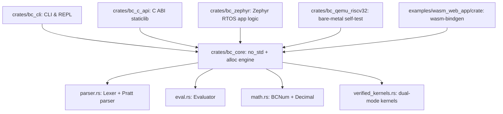

# bc_clone_rs: Design, Verification Architecture & Agent Guide

This document describes the architecture, numerical algorithms, and verification strategy of
`bc_clone_rs`, a Rust implementation of the POSIX `bc` calculator (binary: `bc_clone`). It is the
reference for both human contributors and AI coding agents.

> Development history: v0.1.0–v0.3.0 were written by the Antigravity agent. From v0.4.0 the project
> is developed with Claude Code. Statements in this file are kept in sync with the code; when you
> change behavior or verification coverage, update this file in the same commit.

## Specification

- **Authoritative specification**: POSIX.1-2024 (Issue 8), `bc` utility —
  <https://pubs.opengroup.org/onlinepubs/9799919799/utilities/bc.html>.
- Where POSIX leaves behavior undefined or unspecified, `bc_clone` chooses behavior close to
  GNU `bc` 1.08 and documents it as implementation-defined in `docs/COMPATIBILITY.md`.
- GNU extensions (multi-letter names, `else`, `print`, `continue`, relational operators as
  expressions, bare `return`, …) are accepted by default.
- Results of the `-l` math library are defined as the mathematically exact value truncated toward
  zero at the current `scale`; GNU `bc` output is *not* the oracle for these functions.

## Workspace Layout



| Path | Role |
|---|---|
| `crates/bc_core` | `#![no_std]` + `alloc` engine: lexer, parser, evaluator, arithmetic, math library |
| `crates/bc_cli` | `bc_clone` binary: option parsing, file/stdin processing, interactive REPL, SIGINT |
| `crates/bc_c_api` | C ABI (`include/bc_core.h`): `bc_eval`, `bc_eval_callback`, `bc_session_*` |
| `crates/bc_zephyr` | Zephyr RTOS application logic (self-tests, serial REPL); C trampoline in `examples/zephyr_app` |
| `crates/bc_qemu_riscv32` | Bare-metal RISC-V 32 self-test runner for QEMU `virt` |
| `examples/m5stamp_c3` | ESP32-C3 bare-metal app (`esp-hal`) |
| `examples/wasm_web_app` | Browser frontend backed by `bc_core` compiled to `wasm32-unknown-unknown` |

## Core Engine (`crates/bc_core`)

### Lexer and parser (`src/parser.rs`)
- The lexer tracks line numbers and handles `/* */` comments, strings, and backslash-newline
  continuation.
- The parser is recursive descent, with Pratt precedence climbing for expressions. Assignment and
  `^` are right-associative. Precedence and associativity come from `verified_pratt_infix_info`.
- Fallible API: `Lexer::try_get_next_token`, `Parser::try_new`, `Parser::try_parse_program`.
  `quit` makes `try_parse_program` return `Err("quit")` so execution stops at that point, as
  POSIX requires.

### Numbers (`src/math.rs`)
- `BCNum { coeff: BigInt, scale: usize }` represents `coeff × 10^-scale`. Arithmetic follows the
  POSIX scale rules. The scale and shift computations are delegated to kernels in
  `verified_kernels.rs`.
- Fallible API: `try_div`, `try_mod_op`, `try_pow`, `try_sqrt`. The panicking wrappers (`div`,
  `pow`, …) exist for tests and internal convenience only.
- Output for `obase != 10` uses exact `BigInt` arithmetic. The number of fractional digits is the
  smallest `k` with `obase^k >= 10^scale`, so no floating point or `libm` is needed.
- `Decimal { value: BigInt, prec: usize }` is a fixed-point helper used only by the math library.

### Math library (`-l`)
Every function computes internally with guard digits and truncates to the caller's `scale`.

| Function | Algorithm (as implemented) |
|---|---|
| π (internal) | Machin's formula `π = 4·(4·atan(1/5) − atan(1/239))`, with atan by Taylor series (`get_pi`) |
| `s(x)`, `c(x)` | Reduce `x` modulo 2π into `[-π, π]` with π carrying 10 guard digits plus one digit per integer digit of `x` (`reduce_angle`), then use the Taylor series directly |
| `a(x)` | For `|x| > 1` use `π/2 − atan(1/x)`. Then apply four argument halvings `x/(1+√(1+x²))`, the Taylor series, and multiply by 16 |
| `l(x)` | Write `x = m·2^k` with `m ≥ 0.707`, then use `ln m = 2·artanh((m−1)/(m+1))`. `ln 2` comes from `2·artanh(1/3)` (15 guard digits) |
| `e(x)` | Write `x = n·ln2 + r`, use the Taylor series for `e^r`, then multiply by `2^n`. Extra guard digits scale with the size of `x` |
| `j(n,x)` | Power series of `J_n`; for negative orders, `J_{-n} = (-1)^n J_n` |

Accuracy contract: every result is the exact value truncated toward zero
(`docs/COMPATIBILITY.md` §3.4). `test_math_library_against_high_precision_oracle` in
`crates/bc_cli/tests/integration_tests.rs` checks it against GNU bc at `scale + 100`. GNU's own
results are *not* exact at the requested scale.

### Evaluator (`src/eval.rs`)
- Dynamic scoping: each variable or array name maps to a stack. Function parameters and `auto`
  locals push a new entry on entry. `BTreeMap` keeps the storage `no_std`-friendly and deterministic.
- `ScopeGuard` (RAII) pops the parameter and `auto` frames and restores the caller's control-flow
  flags on every exit path, including `Err` returns and panics.
- Output goes through the `BcWriter` trait. `WrappedStdout` wraps long numbers at 70 columns with
  `\` + newline, as POSIX requires.
- Fallible API: `Evaluator::try_evaluate`, `Evaluator::try_execute`.

### Error handling contract
- `bc_core` itself never needs to panic on user input. Every syntax or runtime error must be
  reachable as an `Err` from the `try_*` APIs.
- Front ends must not rely on unwinding: `catch_unwind` does not work under `panic = "abort"` or on
  `wasm32-unknown-unknown`.
- Errors are typed: `BcError` (`Quit`, `Syntax`, `Runtime { kind: RuntimeError, func }`) in
  `src/error.rs`. Do not match on message strings.
- `src/driver.rs` is the only place that turns input into executed units. `UnitAccumulator`
  groups lines into units, `Evaluator::run_unit` / `run_source` parse and execute them, and
  diagnostics are written in the format of `docs/COMPATIBILITY.md` §3.2. Every front end (CLI,
  C API, Zephyr, QEMU, ESP32-C3, Wasm) uses this driver, so error recovery is identical on all
  targets.
- `bc_cli` additionally wraps each unit in `catch_unwind`. A panic there is a bug in `bc_core`; it
  is reported as `bc_clone: internal error: …` and counted as a failed unit.

## Verified Kernels (`src/verified_kernels.rs`)

Small pure functions are defined once with `dual_verified!` / `dual_verified_repl_scanner!`:

- under Verus (`cfg(verus_keep_ghost)`), they expand inside `verus! {}` with their
  `requires`/`ensures` contracts;
- under normal builds, the same bodies compile as `#[inline]` functions that are called from
  production code.

Examples are the POSIX scale and shift computations for `+ - * / sqrt ^`, digit parsing,
`ibase`/`obase` clamping, the `WrappedStdout` column step, lexer cursor and lookahead bounds, Pratt
precedence, the C-FFI buffer-capacity check, the Zephyr REPL character class, the CLI argument
class, and the REPL block-completeness scanner.

**Preconditions are not checked at runtime; callers establish them.** Several kernels require
`scale <= MAX_VERIFIED_SCALE` (10^9). The evaluator maintains the invariant "every `BCNum` scale is
at most `BC_SCALE_MAX` (= `MAX_VERIFIED_SCALE`)":

- the `scale` register is clamped by `verified_clamp_register`;
- `%` and `^` return `scale too large` instead of producing a larger scale;
- numeric literals with more fractional digits are rejected.

Decimal shifts go through `math::pow10`, which treats a shift above `u32::MAX` as a broken
invariant (an internal error) instead of truncating it. Review any new code that creates a
`BCNum` scale against this invariant.

## Verification Stack — What Is and Is Not Covered

| Layer | Tool / script | What it actually establishes |
|---|---|---|
| Deductive proofs | Verus — `scripts/run_verus_verification.sh` (`verified_kernels.rs`, `verus_proofs.rs`) | The kernels meet their contracts for all inputs that satisfy their preconditions. `verus_proofs.rs` also proves lemmas about ghost models (`SpecBCNum`, …) and **standalone model functions that production code does not call** (e.g. `verified_pow_binary_loop`, `verified_scope_guard_lifecycle`, `verified_trig_range_reduction`). Those results apply to the models, not to `math.rs`/`eval.rs`. |
| Bounded model checking | Kani — `scripts/run_kani_verification.sh` (`kani_proofs.rs`, `bc_c_api`, `bc_cli`) | Kernels are free of overflow and panics over symbolic inputs (64-bit host only). C-API NULL and zero-size guards hold. The CLI brace scanner is consistent. The C-FFI copy harness currently re-implements the copy pattern instead of calling the production code. |
| UB / memory safety | Miri — `scripts/run_miri_tests.sh` | No UB or leaks in the `--lib` unit tests of `bc_core`, `bc_c_api`, `bc_zephyr`, and `bc_cli` (strict provenance, symbolic alignment). |
| Property tests | proptest — `crates/bc_core/tests/proptest_suite.rs` | Algebraic properties (add/sub, mul scale, the div/mod identity), integer base round-trips, and the parser/evaluator do not panic on bounded inputs. There is no value oracle yet, and scales are limited to ≤ 10. |
| Differential tests | `crates/bc_cli/tests/integration_tests.rs`, `scripts/run_gnu_reference_tests.sh`, `scripts/run_posix_compliance_tests.sh` | stdout matches GNU `bc`. stderr is compared only as empty/non-empty, and exit codes are not compared yet. |
| Mutation testing | `cargo mutants` (`.cargo/mutants.toml`) | Diff-based in CI. Some exclusions are broader than the equivalent mutants they target. |
| Coverage | `cargo llvm-cov` | Line coverage gate of 98% in CI. |

The gaps listed above are tracked work for v0.4.0. Do not describe any layer as proving
"bug-freedom" or "100% compliance" of the whole program.

## Embedded and Wasm Targets

- **QEMU bare metal** (`scripts/run_qemu_riscv32_tests.sh`): builds for `riscv32imac` and
  `riscv32imc` and boots under `qemu-system-riscv32 -M virt -bios none`. It uses a 2 MiB
  `embedded-alloc` heap, an NS16550A UART at `0x1000_0000`, and the SiFive test device at
  `0x10_0000` to report the exit status.
- **Zephyr** (`scripts/run_zephyr_tests.sh`): `examples/zephyr_app` builds the `bc_zephyr`
  staticlib through CMake. It is tested on `qemu_riscv32`; `stamp_c3` is the hardware target.
- **C API**: `bc_c_api` embeds a 64 KiB LLFF heap on `no_std` targets. Status codes are defined in
  `include/bc_core.h`.
- **ESP32-C3** (`examples/m5stamp_c3`): built in CI by `scripts/build_m5stamp_c3.sh`. Flashing
  scripts exist for manual hardware testing.
- **Wasm** (`scripts/build_wasm.sh`): runs the `bc_wasm` tests, Clippy for host and wasm32, and
  produces the bundle.

## Agent Workflow Rules

### Pre-commit verification (mandatory)
Run before every commit; do not commit unless everything passes:

```bash
cargo fmt --check && cargo clippy --package bc_core --package bc_clone --package bc_c_api --package bc_zephyr --all-targets -- -D warnings && cargo clippy --package bc_qemu_riscv32 --target riscv32imac-unknown-none-elf -- -D warnings && cargo clippy --package bc_c_api --target riscv32imac-unknown-none-elf --no-default-features -- -D warnings && cargo clippy --package bc_zephyr --target riscv32imac-unknown-none-elf --no-default-features -- -D warnings && cargo test
```

### Process-global state in tests
Signal handlers and panic hooks are process-global. `bc_cli` registers the SIGINT handler only
under `#[cfg(not(test))]`, and tests that touch global state serialize on `TEST_MUTEX`.

### Mutation-testing exclusions
Only exclude mutants that are semantically equivalent (e.g. changes to over-precision guard digits
that cannot change a truncated result). Keep each `exclude_re` in `.cargo/mutants.toml` as narrow
as possible and state the reason next to it.

### Formal-verification hygiene
- New kernels go in `verified_kernels.rs` via `dual_verified!` and must be called from production
  code. A proof about a re-implementation does not count as coverage of the production code.
- Every caller must establish the kernel's `requires` clause.
- Add or extend a Kani harness for each new kernel.
